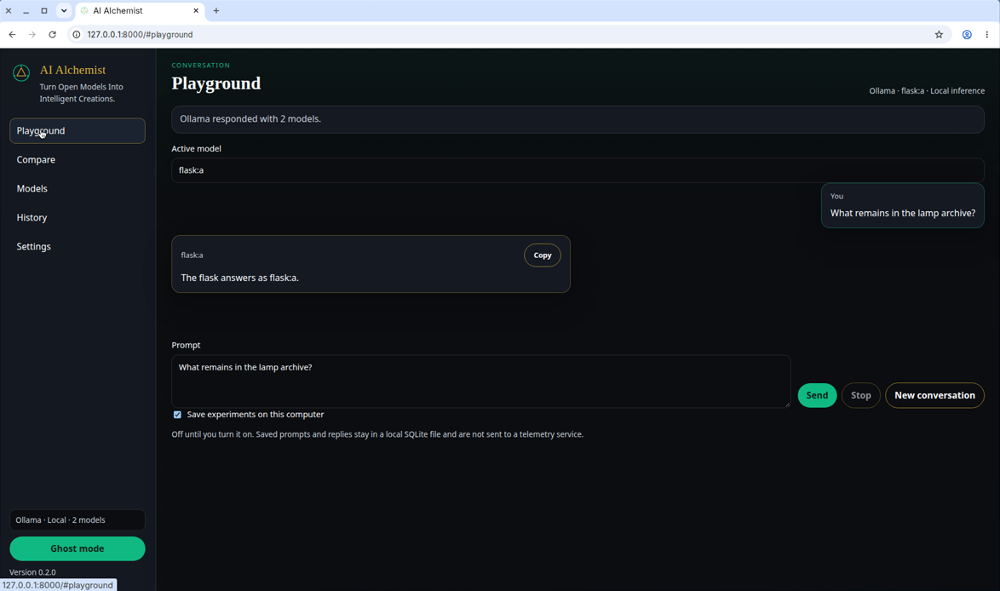

# AI Alchemist


**Turn Open Models Into Intelligent Creations.**



AI Alchemist is a local laboratory for open-weight models. You choose a model, send a prompt, and can compare two models on that same prompt. The page talks to [Ollama](https://ollama.com/) through a small server on your machine. It does not ship a model, and it does not write a reply when Ollama is down.

Version 0.2.0. The command is `ai-alchemist`. The Python package is `ai_alchemist`.

## Start here

You need Python 3.11 or newer. Ollama is required only when you want a real reply. Windows 10/11 and Linux are the systems this release targets.

Linux:

```bash
python3 -m venv .venv
source .venv/bin/activate
python -m pip install -e ".[dev]"
ai-alchemist
```

Windows PowerShell:

```powershell
py -3.11 -m venv .venv
.venv\Scripts\Activate.ps1
python -m pip install -e ".[dev]"
ai-alchemist
```

If `py` is not available, use `python` once Python 3.11 or newer is on `PATH`.

Then open <http://127.0.0.1:8000>. The process binds to loopback. `python -m ai_alchemist` starts the same server. `ai-alchemist --version` prints the version and does not start it.

The `dev` extra installs pytest and Ruff. `python -m pip install -e .` is enough if you only want to run the laboratory. Either install downloads dependencies from PyPI unless they are already cached.

The page loads even when Ollama is not running. The sidebar chip then reads `Ollama · Unavailable`. A prompt in that state shows the connection error. It does not show a made-up answer.

## Send a first prompt

1. Install Ollama from <https://ollama.com/download>.
2. Start it with `ollama serve` if it is not already running.
3. Pull a model yourself. AI Alchemist does not choose one and does not run `ollama pull`. Read the license on the tag you pull. One example is `ollama pull qwen2.5-coder:1.5b`.
4. In the app, open **Settings**.
5. Leave the host at `http://127.0.0.1:11434` unless your Ollama server is somewhere else.
6. Put the tag you pulled in **Default model**. Put a second tag in **Comparison model** if you want Compare to be filled in.
7. Choose **Test connection**, then **Save**.

A loopback host (`127.0.0.1`, `localhost`, or `::1`) is labeled local. Any other host is labeled remote, and prompts are sent there. **Test connection** checks the form without saving it.

Open **Playground**, confirm **Active model**, write a prompt, and choose **Send**. Enter sends the prompt. Shift+Enter inserts a line break. **Stop** aborts the browser read. A stopped partial reply is not written to history. It stays on screen, so the next prompt includes it until you choose **New conversation**. **New conversation** clears the screen and does not delete saved rows. **Copy** copies a finished reply.

A follow-up prompt includes the earlier user and assistant text from that screen. Messages marked as errors are left out. This release does not add a system prompt.

## Pages

| Page | What it is for |
| --- | --- |
| Playground | One model, a streaming reply, stop, copy, and a new conversation. |
| Compare | The same prompt sent to two model names. Each side succeeds or fails on its own. The page does not rank the replies. |
| Models | Tags returned by Ollama `GET /api/tags`, including family, parameter size, quantization, and size when Ollama sent them. This page does not add scores. |
| History | Saved prompts and replies, with **Delete** and **Delete all**. |
| Settings | Host, optional bearer token, both model names, output cap, and the history switch. |

**Ghost mode**, at the bottom of the sidebar, is a darker theme. The button label becomes **Ghost mode on**. The choice stays in this browser only (`localStorage`). It does not change the model or the settings file.

Compare needs two model names. If Ollama lists fewer than two tags, the page says so and still lets you type a name that is already installed. **Refresh models** asks Ollama for the list again. One Ollama server is enough when both tags are installed there.

## Saving experiments

Saving is off until you turn on **Save experiments on this computer**. That checkbox is on Playground and on Settings. They change the same setting.

When it is on, a finished Playground or Compare turn is written to `experiments.sqlite`, next to the settings file. Each row stores the prompt, reply, model, provider, kind (`playground` or `compare`), and time. History lists those rows. A turn that contains the saved bearer token is not written, and the page says so.

**New conversation** and **Stop** do not delete rows. **Delete** and **Delete all** do.

## Settings file

Settings are JSON:

- Linux: `$XDG_DATA_HOME/ai-alchemist/lab-config.json`, or `~/.local/share/ai-alchemist/lab-config.json`
- Windows: `%LOCALAPPDATA%\ai-alchemist\lab-config.json`

`AI_ALCHEMIST_DATA_DIR` replaces the directory. `AI_ALCHEMIST_CONFIG` replaces the file path. The file mode is owner read/write (`0600`) when the operating system allows it. An older inspector file named `config.json` is not read. Unknown keys in `lab-config.json` are rejected.

| Setting | Default | In the form |
| --- | --- | --- |
| `ollama_host` | `http://127.0.0.1:11434` | Ollama host |
| `ollama_token` | empty | Bearer token |
| `default_model` | empty | Default model |
| `compare_model` | empty | Comparison model |
| `max_output_tokens` | 512 (16–4096) | Maximum output tokens |
| `persist_experiments` | off | Save experiments on this computer |
| `connect_timeout_seconds` | 3 | Not shown. Kept when you save the form. |
| `request_timeout_seconds` | 120 | Not shown. Kept when you save the form. |

Model names must be one token, up to 128 characters, using letters, digits, and `_ . : @ + / -`. A blank model name is allowed in Settings. Playground will not send until **Active model** has a name.

The bearer token is optional. It is for an Ollama-compatible server that requires `Authorization: Bearer`. Leave the field blank to keep a saved token. Check **Clear the saved token** and save to remove it. After a successful save the field is emptied on purpose: the token stays in `lab-config.json` and is not returned to the page. Do not put a username or password in the host URL. Those URLs are rejected.

## Run options

```bash
ai-alchemist --host 127.0.0.1 --port 8000
```

`--host` defaults to `127.0.0.1`. `--port` defaults to `8000`. Binding to `0.0.0.0` or `::` prints a warning on stderr: anyone who can reach that port can read history and change settings.

Interactive API docs are at <http://127.0.0.1:8000/docs>. `GET /api/health` reports the process only. It does not check Ollama.

| Route | Role |
| --- | --- |
| `GET /api/health` | Name, version, and `status: ok` |
| `GET /api/provider` | Whether the saved host answered |
| `GET /api/models` | Tags from that host |
| `GET` and `PUT /api/settings` | Public settings. The token value is never included. |
| `POST /api/settings/test` | Probe the form without saving it |
| `POST /api/chat/stream` | Playground tokens as server-sent events |
| `POST /api/compare` | One prompt, two models |
| `GET /api/history` | Stored rows |
| `DELETE /api/history/{id}` and `DELETE /api/history` | Delete one row, or every row |

## How the pieces fit

The browser is a static page. FastAPI serves that page and the JSON API. The browser does not call Ollama itself.

```text
Browser (Playground, Compare, Models, History, Settings)
  -> FastAPI routes
       -> Ollama adapter (GET /api/tags, POST /api/chat)
       -> optional SQLite history
       -> lab-config.json
```

| Path | Responsibility |
| --- | --- |
| `src/ai_alchemist/web/` | The pages |
| `src/ai_alchemist/routes.py` | HTTP API |
| `src/ai_alchemist/providers/` | Provider protocol and the Ollama adapter |
| `src/ai_alchemist/history.py` | Experiment rows |
| `src/ai_alchemist/config.py` | Settings and the token file |
| `src/ai_alchemist/cli.py` | The `ai-alchemist` process |

This release registers one provider: Ollama. A loopback host is local execution. Any other host is remote execution. Redirects are not followed. The chat payload has no `tools` field, and a `tool_calls` reply is an error. Hugging Face and other hosts are not built in. A URL that does not speak the Ollama HTTP API will fail.

Output length is Ollama's `num_predict`, set from `max_output_tokens`.

The module map is [docs/architecture.md](docs/architecture.md). The security notes are [docs/security.md](docs/security.md).

## Privacy

- History is off by default. When it is on, prompts and replies are stored in plaintext SQLite. They are not sent to a telemetry service. There is no analytics call.
- A saved token is sent only as a header to the configured host. It is scrubbed from provider errors. It is not written into the page or into an experiment row.
- A loopback host keeps inference on this machine. A remote host receives the prompt, and the interface says so.
- Do not paste other secrets into prompts. History stores the prompt text. The only secret the saver looks for is the configured token.
- The server binds to loopback unless you change `--host`. A non-loopback bind exposes history and settings to clients that can open the port.

## Tests

From the activated environment, after `pip install -e ".[dev]"`:

```bash
python -m pytest
python -m ruff check src tests
```

Tests use a fake provider and `httpx.MockTransport`. They do not start Ollama. A passing run is not a live inference check. To check a real model, start Ollama, pull a tag, and send a prompt in Playground.

## Troubleshooting

| What you see | What it means |
| --- | --- |
| The chip says `Ollama · Unavailable` | Ollama is not running, or the host is wrong. The page still opens. Start `ollama serve`, or fix **Ollama host**. |
| An error names a missing model and shows `ollama pull` | That tag is not installed. The app will not download it. |
| Compare says two models are required | The connected host listed fewer than two tags. Pull another tag yourself, or type a second installed name. |
| A reply is an error panel | That text is the provider error. It is not a substitute answer. |
| **Stop** left a partial sentence | The browser aborted the read. Partial text is not saved. The provider may keep working until its own timeout. |
| Settings say the host is remote | The host is not loopback. Prompts leave this machine. |
| The token field is empty after **Save** | The token remains in `lab-config.json` and is not shown again. |
| Playground says to enter a model name | **Default model** is empty until you set one. |

## Contributing

See [CONTRIBUTING.md](CONTRIBUTING.md) and [CODE_OF_CONDUCT.md](CODE_OF_CONDUCT.md).

- Keep provider HTTP code in `src/ai_alchemist/providers/`.
- Do not execute prompts as shell commands, and do not give the model a tool channel.
- Do not replace a provider failure with a canned reply.
- Do not log or return saved tokens.
- Cover new behavior with pytest, including the failure path. Do not require a live model server.

## Earlier version

This repository used to contain a read-only terminal inspector for Git repositories (`inspect`, `history`, `explain`, `haunt`). That program is not in this tree. Git history still has it. Laboratory settings do not migrate the old `config.json`.

[docs/dev-community-article.md](docs/dev-community-article.md) is the Week 4 submission outline. [CHANGELOG.md](CHANGELOG.md) lists what 0.2.0 removed. The mark at `docs/assets/mark.svg` and `src/ai_alchemist/web/mark.svg` is the same drawing.

## Why the model stays swappable

The laboratory is useful because the model is a name you can change. Ollama runs open-weight models on a machine you control, and the host field can point at another server that speaks the same HTTP API. A prompt does not have to go to one proprietary API for the page to work.

Local means the host address is loopback. Remote is labeled remote. Comparison shows two replies and does not invent a score. Open weights are not one license: a model card may be Apache-2.0, a research license, or something else, and an Ollama package can add its own terms. Read the card for the tag you pull.

## License

The application is [MIT](LICENSE), copyright 2026 AI Alchemist Contributors.

FastAPI, Starlette, Uvicorn, HTTPX, Pydantic, and their dependencies come from PyPI and keep their own licenses. Ollama and any model weights you pull are separate works. The MIT license in this repository does not relicense them.

This release was checked with mocked provider tests. It was not certified against a particular Ollama version beyond the `/api/tags` and `/api/chat` fields the adapter reads.
