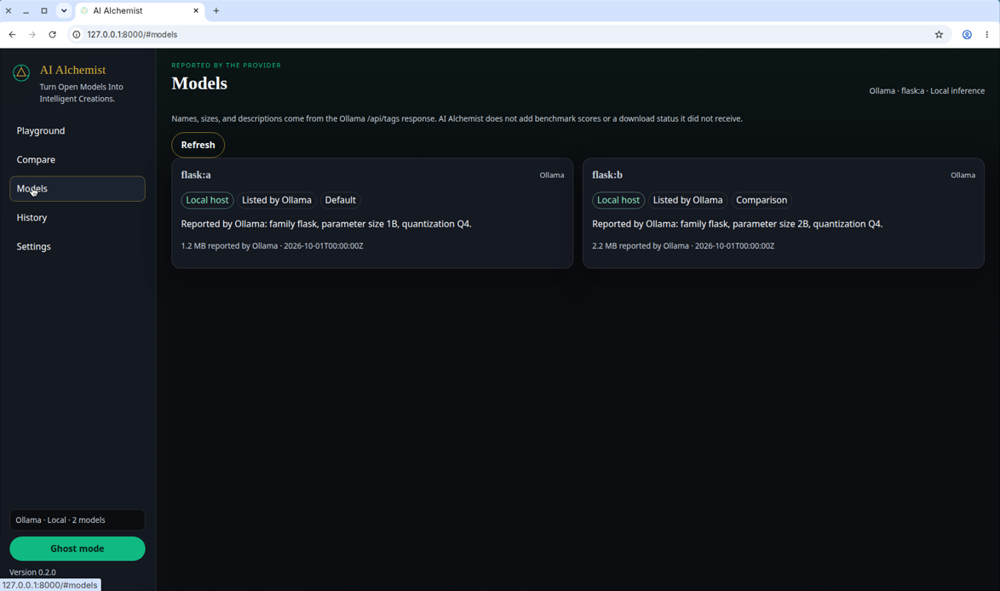

*This is a submission for the [Hacktoberfest Open-Source AI Challenge Week 4: Ghost in the Machine](https://dev.to/challenges/hacktoberfest-week4-2026-10-26)*

## What I Built

[AI Alchemist](https://github.com/gabutersproject/ai-alchemist) is a local laboratory for open-weight models. The tagline is "Turn Open Models Into Intelligent Creations."

I wanted a page where I can talk to a model, see which model is answering, and put two models next to each other on the same prompt. The model runs through [Ollama](https://ollama.com/) on my machine. The page does not invent a reply when Ollama is down, and it does not download weights for me.

The pieces are:

- **Playground.** I type a prompt, the reply streams in, and I can stop it, copy it, or start a new conversation.
- **Compare.** The same prompt goes to two model names. Each side can succeed or fail on its own. The page does not rank them.
- **Models.** The list is whatever Ollama returns from `GET /api/tags`. Family, size, and quantization show up only when Ollama sent them.
- **History.** Saving is off until I turn it on. Rows stay in a SQLite file on this computer.
- **Ghost mode.** A darker laboratory theme for the Week 4 theme. It changes the look, not the model.

A loopback Ollama host is labeled local. Any other host is labeled remote, so I do not pretend a remote server is running on the laptop.

## Demo

There is no hosted demo. I run it myself:

```bash
python -m pip install -e .
ollama serve
ollama pull qwen2.5-coder:1.5b
ai-alchemist
```

Then I open <http://127.0.0.1:8000>, set the model name in Settings, and send a prompt.

These photographs were taken in the browser while that server was running.




The first screen is the playground after a reply. The second is the model list reported by the connected Ollama host. The address bar is `127.0.0.1:8000`.

## Code

The repository is [github.com/gabutersproject/ai-alchemist](https://github.com/gabutersproject/ai-alchemist). The application is MIT.

The parts that matter:

| Path | What it does |
| --- | --- |
| `src/ai_alchemist/web/` | The pages |
| `src/ai_alchemist/routes.py` | The HTTP API |
| `src/ai_alchemist/providers/ollama.py` | Ollama `/api/tags` and `/api/chat` |
| `src/ai_alchemist/history.py` | Local experiment rows |
| `src/ai_alchemist/config.py` | Host, token, and model names |

The command is `ai-alchemist`. The Python package is `ai_alchemist`. Version 0.2.0.

## How I Built It

The browser is a static page. A small FastAPI server holds the settings and talks to Ollama. The page never calls Ollama directly, so a bearer token stays in the settings file and is not written into the JavaScript.

Ollama is the only provider. The adapter sends `POST /api/chat` with streaming on, and it does not send a tools list. If the model asks for a tool call, the app reports that and does not run a command. Redirects are refused. An empty or broken body is an error, not a paragraph I wrote myself.

Model names come from `GET /api/tags`. I did not add benchmark scores. Comparison runs the same user prompt twice with `asyncio.gather`, so one failure does not erase the other reply.

Ghost mode is a CSS class stored in the browser. History is a SQLite file next to `lab-config.json`, and it stays off until I opt in.

Tests use a fake provider and `httpx.MockTransport`. They do not need a live model. A real check is still `ollama serve`, a model I pulled myself, and a prompt in the playground.

## Why Does Open Innovation Matter?

The useful part is that the model is a name I can change. Ollama runs open-weight models on a machine I control. The same page can point at another server that speaks the Ollama HTTP API. I do not have to send the prompt to one proprietary API for the laboratory to work.

Local inference is real only when the host is loopback. The interface says so. If I point the host somewhere else, it says remote. That honesty matters more than a badge that says "open."

Open weights are not one license. A model card may be Apache-2.0, a research license, or something else, and an Ollama package can add its own terms. I read the card for the tag I pull. AI Alchemist does not run `ollama pull` for me.

## The Spirit of It

Week 4 asked for a ghost in the machine. I did not want a jump scare. I wanted the feeling of a model that is actually sitting in the computer, and a page that goes quiet when that model is not there.

Ghost mode is the dark laboratory: obsidian, emerald, and gold. The ghost is the model answering from Ollama. If Ollama is unreachable, the chip says unavailable and the prompt returns the connection error. There is no stand-in voice pretending the machine still spoke.

## Prize: Best Use of Ollama

I am submitting this for the best use of Ollama.

Ollama is not a mention in the README. It is the inference path:

- The playground streams `POST /api/chat`.
- The model page reads `GET /api/tags` and shows only what that response contained.
- Two installed tags can be compared on one prompt.
- A loopback host is called local. Any other host is called remote.
- The app does not download models, does not follow redirects, and does not run tool calls.
- When Ollama is down, the page says so instead of writing a fake answer.

That is the use I wanted: pick an open-weight tag, run it through Ollama, and see the reply on my own machine.
